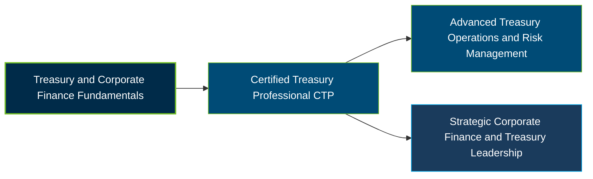

# AFP Certified Treasury Professional Certification Exam Guide

A dedicated, comprehensive study guide and treasury management reference repository for candidates preparing for the **AFP Certified Treasury Professional (CTP) Certification Exam**.

---

## Exam Overview

The AFP Certified Treasury Professional certification validates the knowledge and skills required to manage corporate treasury activities, including liquidity, capital structure, financial risk, banking relationships, and treasury technology.

- **Exam Format**: Computer-based, multiple-choice examination administered at Pearson test centers.
- **Target Audience**: Treasury Professionals, Cash Managers, Corporate Finance Professionals, Treasury Analysts, and Finance Managers.
- **Prerequisites**: Two years of full-time corporate finance-related experience, or one year of experience with a qualifying graduate-level business or finance degree. See AFP eligibility requirements.

---

## Core Exam Domains & Knowledge Areas

### 1. Maintain Corporate Liquidity Required to Meet Current and Future Obligations

- Manage cash positioning, short-term investments, borrowing, and cash flow forecasting.
- Manage banking structures, foreign exchange exposure, trade financing, and intercompany financing.
- Reconcile cash balances and optimize treasury operations and financial ratios.

### 2. Manage Capital Structure, Long-Term Capital Costs, and Investments

- Manage syndicated agreements, investment portfolios, and revolving debt agreements.
- Manage debt and equity issuance, post-issuance compliance, dividends, and retirement.
- Evaluate market conditions, mergers and acquisitions, and financial exposure hedging.

### 3. Manage Internal and External Relationships

- Build and maintain relationships with banks and external financial service providers.
- Administer bank accounts, documentation, service agreements, and provider selection.
- Support internal stakeholders across accounting, IT, legal, audit, tax, and finance.

### 4. Monitor and Control Corporate Financial, Regulatory, and Operational Risk

- Apply treasury policies, procedures, internal controls, and regulatory compliance requirements.
- Detect fraud, assess counterparty risk, and manage financial and operational exposure.
- Maintain business continuity plans and oversee merchant services controls.

### 5. Assess the Impact of Technologies on the Treasury Function

- Use ERP systems, e-commerce platforms, payment technologies, and treasury management systems.
- Identify technology security concerns, information security risks, and cyber-related threats.
- Implement treasury products, banking services, and treasury workstation solutions.

---

## Certification Path

The following diagram represents a suggested professional learning progression, not an official AFP certification pathway.

---

## Recommended Practice & Study Resources

To prepare effectively, combine AFP's official learning materials with treasury management concepts and practical financial analysis:

- **CertsGate**: Explore [AFP CTP study materials and practice resources](https://certsgate.com/exams/afp/ctp) to review treasury management concepts and assess your knowledge.
- **Practical Treasury Study**: Apply cash flow forecasting, liquidity analysis, bank reconciliation, working capital management, and financial risk assessment using practical corporate finance scenarios.
